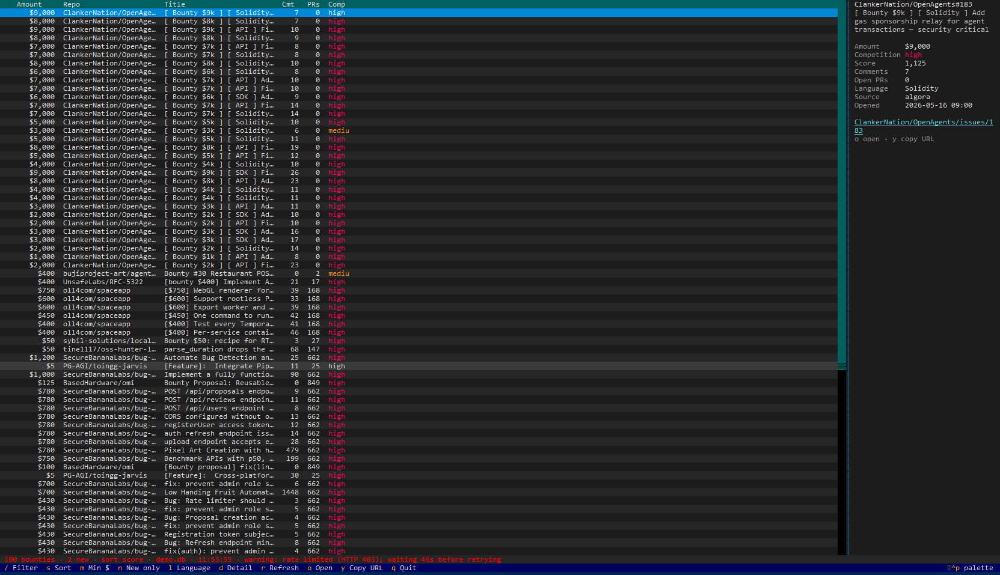
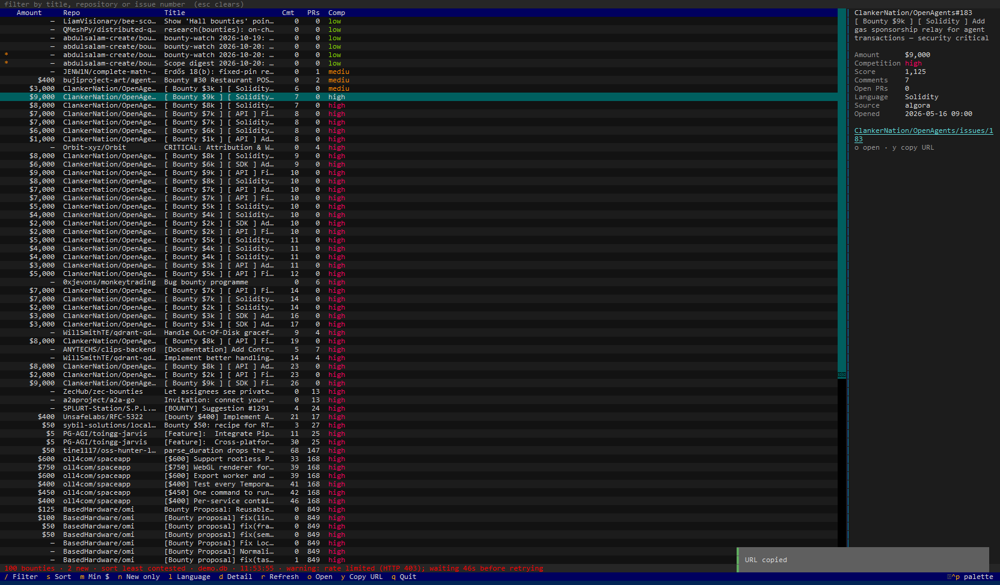

# Active Bounty Radar

Find open, paid open-source bounties on GitHub and rank them by what they are actually
worth relative to how contested they are.

`bounty-core` is a single static binary. It searches GitHub for bounty-labelled issues,
understands the many ways people write dollar amounts, removes duplicates, scores
competition, and prints one clean JSON array that pipes straight into `jq`.

---

## Screenshots

**The dashboard, ranked by score.** A live scan of paid GitHub issues. The `$9,000`
issue leads because it is barely contested — 7 comments, no open pull requests — not
because it is merely the largest number on screen. The right-hand pane holds the full
record for the selected row: amount, competition, score, comment and open-PR counts,
language, source, and when it was opened.



**The same scan, sorted by least contested** — `s` reorders locally, so switching
costs no GitHub request. `y` copies the selected issue's URL to the clipboard.



Both screenshots are the real `bounty tui` in a real terminal, including the warning
about the GitHub rate limit in the status bar.

---

## Why this exists

Bounty hunting on GitHub is a search problem, and the search is bad.

**Listings are scattered and labelled inconsistently.** A paid issue might carry an
`💎 Bounty` label, a plain `bounty` label, or nothing but the word "bounty" in the title.
One project uses all three across different issues. Checking them means running three
separate GitHub searches and stitching the results together by hand, every session.

**Amounts are written every way imaginable.** `$10K`, `$10k`, `$10.5k`, `$1,000`,
`USD 200`, `200 USD`, `€50`, `£30`, `US$250`. Any tool that expects one exact form
misreads the rest — a five-figure bounty silently becomes a two-figure one, and the most
valuable work drops to the bottom of the list.

**A raw list is not a shortlist.** A `$9,000` issue with forty comments and a dozen open
pull requests is a worse use of an afternoon than a `$2,000` issue with two comments.
Sorting by amount alone points you at the most crowded room.

**Long sessions hit the API wall.** Unauthenticated GitHub search allows roughly ten
requests a minute, and refuses to page past a thousand results per query. Tools that
ignore this either stop early and look complete, or stall with no explanation.

**Machine output is usually unusable.** Progress banners and log lines mixed into
stdout break `jq`, spreadsheets and scripts. The data has to be separate from the
chatter.

**The same issue arrives several times.** One issue appearing in a label search *and* a
title search becomes two rows in your list, twice the noise.

Active Bounty Radar was built to answer one question in a single command: *which of
these bounties is worth my time right now?*

---

## What it does

| Problem | What `bounty-core` does |
|---|---|
| Three discovery conventions | Runs the `💎 Bounty` label, the `bounty` label and the `bounty` title search in one pass |
| Amounts written inconsistently | Case-insensitive parser for `K`/`M` suffixes, thousands separators, `USD`/`EUR`/`GBP` before or after the number, `$`/`€`/`£` symbols |
| False amounts | Sanity bounds: `$0` and anything above $1,000,000 is rejected, as are issue numbers and stray integers |
| Noise over value | Competition score from comment count plus open pull requests; ranking is dollars *per unit of competition* |
| Rate limits and result caps | Token support, `per_page=100` pagination up to GitHub's 1,000-result limit per query, `Retry-After`/`x-ratelimit-reset` aware backoff |
| Unusable output | JSON array on stdout, every diagnostic on stderr |
| Duplicates | Merged by `(repository, issue number)`, keeping the best amount and highest competition counts |

---

## What is in the repository today

The scanning engine is implemented, tested and installable from source:

```
core/          Go engine — builds the bounty-core binary
  internal/
    github/    REST client: pagination, auth, rate limiting, backing off
    parse/     amount parser
    dedup/     duplicate merging
    rank/      competition scoring and sort orders
    scan/      query fan-out, filters, enrichment, orchestration
cli/           Python front ends (`bounty`): table, history, JSON passthrough, TUI
Screenshots/   Dashboard screenshots used by this README
tests/         Offline integration tests against a stub GitHub API
```

`bounty-core` is the machine interface: JSON on stdout, diagnostics on stderr. On top
of it, `bounty` renders a table, remembers what you have already seen, and opens a
full-screen dashboard when you want to sort and read without another scan.

---

## Install

Requires **Go 1.22 or newer**. No third-party dependencies.

```bash
git clone https://github.com/Rehan-nawroz/active-bounty-radar.git
cd active-bounty-radar/core
go build -o ../bin/bounty-core .
```

On Windows the binary is written to `bin/bounty-core.exe`. To call it from anywhere,
add the `bin` directory to your `PATH`.

Check the build:

```bash
./bin/bounty-core version
```

---

## Quick start

```bash
# 15 highest-value, least-contested bounties across all three searches
./bin/bounty-core scan --limit 15
```

That works without a token. For anything more than a quick look, set one:

```bash
export GITHUB_TOKEN=ghp_...          # Windows PowerShell: $env:GITHUB_TOKEN = "ghp_..."
./bin/bounty-core scan --limit 50
```

A token raises the limit from ~10 search requests/minute to 5,000/hour and turns on
repository enrichment (language and open-PR counts).

---

## Usage

```
bounty-core scan [flags]
```

| Flag | Default | Meaning |
|---|---|---|
| `--min N` | `0` | Keep only bounties worth at least `N` USD |
| `--max-comments N` | `-1` | Keep only bounties with at most `N` comments (`-1` disables) |
| `--lang LIST` | — | Restrict to GitHub languages, comma separated; repeatable |
| `--limit N` | `100` | Maximum bounties returned; `0` means no truncation |
| `--source LIST` | all | `algora`, `label`, `title`; comma separated; repeatable |
| `--sort KEY` | `score` | `score`, `amount`, `comments`, `newest`, `oldest` |
| `--enrich MODE` | `auto` | `auto` (on when a token is set), `on`, `off` |
| `--pretty` | off | Indented JSON |
| `--timeout DUR` | `120s` | Overall scan deadline |
| `--max-retries N` | `3` | Retries per request for rate limits and 5xx responses |
| `--verbose` | off | Progress on stderr |
| `--json` | — | Accepted for explicitness; JSON is always the output |

Source names: `algora` is the `💎 Bounty` label convention used for funded campaigns,
`label` is a plain `bounty` label, and `title` is the word "bounty" in an issue title.

### Examples

```bash
# Only real money, least contested first
./bin/bounty-core scan --min 1000 --sort comments --limit 10

# Two languages at once (one query set per language, since GitHub ANDs qualifiers)
./bin/bounty-core scan --lang go --lang rust --limit 25

# Freshest bounties, one discovery source only
./bin/bounty-core scan --source title --sort newest --limit 10

# See how much work a scan will do before it runs
./bin/bounty-core scan --verbose --limit 10
```

### Scripting the output

```bash
# How many did we find?
./bin/bounty-core scan | jq 'length'

# A shortlist: amount, competition, link
./bin/bounty-core scan --limit 50 \
  | jq -r '.[] | select(.amount_usd >= 1000) | "\(.amount_usd)\t\(.competition)\t\(.url)"'

# Bounties in Go repositories, most valuable first
./bin/bounty-core scan --lang go \
  | jq -r 'sort_by(-(.amount_usd // 0))[] | "\(.amount_usd // "?")\t\(.repo) — \(.title)"'

# No jq? Any Python 3 works too (Windows: `py -3` or `uv run python`)
./bin/bounty-core scan | python3 -c "import json,sys; [print(b['amount_usd'], b['url']) for b in json.load(sys.stdin) if b['amount_usd']]"
```

Because diagnostics never touch stdout, a scan that hits a rate limit still leaves
valid JSON on the pipe; the warnings appear on stderr.

---

## Output format

A JSON array — one object per bounty:

```json
[
  {
    "id": "acme/widget#42",
    "repo": "acme/widget",
    "number": 42,
    "title": "Add gas sponsorship relay for agent transactions",
    "url": "https://github.com/acme/widget/issues/42",
    "amount_usd": 9000,
    "currency": "USD",
    "source": "algora",
    "comments": 7,
    "open_prs": 2,
    "language": "Solidity",
    "created_at": "2026-05-16T09:00:48Z",
    "competition": "high",
    "score": 750
  }
]
```

| Field | Notes |
|---|---|
| `id` | `owner/repo#number`, the deduplication key |
| `amount_usd` | Integer USD, or `null` when no plausible amount was written |
| `currency` | Currency the amount was written in; EUR/GBP converted with fixed rates |
| `source` | Which search found it: `algora`, `label`, `title` |
| `open_prs` | Open pull requests in the repository (a contention proxy, not per-issue links) |
| `language` | Repository language, empty unless enrichment ran |
| `competition` | `low`, `medium`, `high` — from `comments + 2 × open_prs` |
| `score` | `amount_usd / (1 + comments + 2 × open_prs)`; unknown amounts score `0` |

`competition` buckets: weight ≤ 1 is `low`, ≤ 6 is `medium`, above that is `high`.

---

## Rate limits and enrichment

- **With `GITHUB_TOKEN` (or `GH_TOKEN`):** 5,000 requests/hour. Enrichment is on by
  default, adds repository language and open-PR counts, and enriches up to 50
  repositories per scan.
- **Without a token:** ~10 search requests/minute. Enrichment stays off unless forced,
  and is capped at 10 repositories when forced.
- **When throttled:** the request is retried after GitHub's stated wait, with a warning
  on stderr. If the required wait is longer than 75 seconds the scan fails with a clear
  message rather than hanging.
- **Permanent failures** — refused connections, DNS errors — fail immediately instead of
  burning retries.

---

## Command-line front end (`bounty`)

The engine prints JSON; `bounty` is the part you actually use. It renders a readable
table, saves every scan, and tells you which bounties you have not seen before.

### Install

From a checkout, using [uv](https://docs.astral.sh/uv/):

```bash
uv venv .venv
uv pip install --python .venv -e ./cli

.venv/Scripts/bounty --help      # Windows
.venv/bin/bounty --help          # macOS / Linux
```

The CLI finds the engine in this order: `--core`, `BOUNTY_CORE_BIN`, the checkout's
`bin/` directory, `PATH`, and finally a one-off build with Go when the toolchain is
available.

### Commands

| Command | What it does |
|---|---|
| `bounty scan` | Find, rank and save a scan |
| `bounty tui` | Full-screen dashboard: filter, sort, read, rescan |
| `bounty history` | Show past scans and how many bounties were new |

`bounty scan` accepts every engine flag (`--min`, `--max-comments`, `--lang`, `--limit`,
`--source`, `--sort`, `--enrich`, `--timeout`, `--verbose`) plus:

| Flag | Meaning |
|---|---|
| `--json` | Print the engine's JSON unchanged, ready for jq |
| `--new` | Only bounties not seen in a previous scan |
| `--db PATH` | History database location |
| `--core PATH` | Path to the bounty-core engine |

`bounty history` takes `--limit N`, `--json` and `--db PATH`.

`bounty tui` takes the same scan flags except `--json`, `--new` and `--verbose` — a
dashboard has nothing to pipe, and engine warnings would print over the display (they
are shown in the status bar instead).

### Dashboard

```bash
bounty tui
bounty tui --min 1000 --lang go
```

See the [screenshots](#screenshots) for what this looks like in a real terminal.

A scan runs as soon as the dashboard opens, and every refresh is saved like a normal
scan, so "new" markers and `bounty history` stay consistent. `--sort` sets the opening
order; `s` cycles from there.

| Key | Action |
|---|---|
| `/` | Filter by title, repository or issue number (escape clears) |
| `s` | Cycle sort: score, amount, least contested, newest, oldest |
| `m` | Cycle the minimum amount ($0 → $100 → $500 → $1,000 → $5,000 → $10,000) |
| `n` | Show only bounties not seen before |
| `l` | Cycle the language filter (only languages in this scan) |
| `d` | Show or hide the detail pane |
| `r` | Rescan GitHub |
| `o` / `y` | Open the selected bounty, or copy its URL |
| `q` | Quit |

Rows are marked `*` when new. The detail pane shows the amount, competition, score,
comment and open-PR counts, language, source, creation date and issue link. On
terminals narrower than 110 columns it hides itself so every table column stays
visible; `d` overrides that for the session. Sorting and filtering happen locally, so
none of them cost a GitHub request.

The dashboard needs an interactive terminal: `bounty tui` exits with status 2 when
stdout is a pipe, which keeps scripts on `bounty scan`.

### Examples

```bash
bounty scan --min 1000 --sort comments --limit 15
bounty scan --json | jq -r '.[] | select(.amount_usd > 5000) | .url'
bounty history --limit 5
```

New bounties carry a `*` marker and are shown in bold. `--json` writes the engine's
bytes through untouched, so existing pipelines keep working. `--new` is a table-only
view and is refused together with `--json`, precisely so that guarantee stays absolute.

### Where the history lives

`~/.local/share/bounty-radar/history.db` on Linux, `~/Library/Application
Support/bounty-radar/history.db` on macOS, and `%LOCALAPPDATA%\bounty-radar\history.db`
on Windows. Override with `BOUNTY_DB` or `--db`.

A bounty is "new" the first time its `owner/repo#number` is recorded. Later scans
refresh its amount, comments and score but keep the original first-seen time.

## Exit codes

| Code | Meaning |
|---|---|
| `0` | Scan completed (partial source failures are reported on stderr, results still printed) |
| `1` | Runtime error: every search failed, or output could not be written |
| `2` | Usage error: unknown flag or command, invalid value, unknown source, or `bounty tui` without a terminal |
| `130` | Interrupted with Ctrl+C |

---

## Known limitations

- Amounts are read from issue titles and labels only. An amount buried in the issue body
  is not picked up, which deliberately avoids matching prose and code blocks.
- `open_prs` is the repository's open pull request count — a contention proxy. It does
  not tell you how many pull requests are linked to *that* issue.
- Currency conversion uses fixed approximate rates (EUR → 1.10, GBP → 1.27) so results
  are deterministic and work offline. Converted values are estimates.
- Without a token, enrichment covers at most 10 repositories, so `language` and
  `open_prs` are partial by design.
- `--limit 0` removes truncation from the merged result, but GitHub still stops each
  individual query at 1,000 results.
- The history database grows with every scan and is never pruned; deleting the file is
  safe and simply resets "new" detection.
- The dashboard is keyboard-driven and works best on a modern terminal; `y` uses OSC 52
  to reach the system clipboard, which some terminals and multiplexers disable.

---

## Development

The engine has no third-party dependencies; everything runs on the standard library.

### Go engine

```bash
cd core
gofmt -l .          # should print nothing
go vet ./...
go test ./...

# The concurrent enrichment pass is checked by the race detector.
# Needs a C compiler on PATH (cgo).
CGO_ENABLED=1 go test -race ./...
```

On Windows a portable MinGW-w64 toolchain is enough; point `PATH` at its `bin`
directory and set `CGO_ENABLED=1`.

### CLI integration tests

`tests/` drives the built binary and the `bounty` CLI exactly as a user would: real
processes, real stdout and stderr, with a local stub standing in for the GitHub API so
nothing touches the network or your rate limit. The dashboard is driven headlessly with
Textual's test harness, so its keys, filters, scan worker and layout are exercised
without needing a terminal.

```bash
uv venv .venv
uv pip install --python .venv -r requirements-dev.txt -e ./cli

.venv/Scripts/python -m pytest tests -q      # Windows
.venv/bin/python -m pytest tests -q          # macOS / Linux
```

Three of those tests execute the `jq` examples from this README. They are skipped
unless `jq` is on `PATH`; point at a specific binary with `JQ=/path/to/jq`.

Build the engine first (`cd core && go build -o ../bin/bounty-core .`), or let the
tests build it when `go` is available. The `-e ./cli` above installs the command the
CLI tests invoke.

---

## License

Apache License 2.0. See [LICENSE](LICENSE).
